<a href="https://antoniopaya22.github.io">
  <picture>
    <source media="(prefers-color-scheme: dark)" srcset="./assets/banner-dark.svg" />
    <source media="(prefers-color-scheme: light)" srcset="./assets/banner-light.svg" />
    
  </picture>
</a>

<p align="center">
  <a href="https://antoniopaya22.github.io"></a>
  <a href="https://www.linkedin.com/in/antoniopaya22"></a>
  <a href="https://scholar.google.es/citations?user=4bCBOysAAAAJ"></a>
  <a href="https://orcid.org/0000-0003-3733-3805"></a>
  <a href="https://medium.com/@antonioalfa22"></a>
  <a href="mailto:antoniopaya@outlook.com"></a>
</p>

```ts
export const antonio = {
  name: 'Antonio Payá González',
  roles: ['Software Architect @ TheNextPangea', 'Professor @ UNIR'],
  phd: { field: 'Software Engineering', university: 'University of Oviedo', year: 2025 },
  research: ['Software-Defined Perimeter', 'Zero Trust', 'Intrusion Detection', 'Adversarial ML'],
  location: 'Gijón, Asturias, Spain',
  openToCollab: true, // ✓
} as const;
```

### `$ whoami`

- 🏗️ **Software Architect** at [TheNextPangea](https://thenextpangea.com/): scalable cloud architectures on AWS, Azure and GCP, AI models in production, infrastructure as code with Terraform and Security by Design.
- 👨‍🏫 **Professor** at [UNIR](https://www.unir.net/) (since Sept 2026): Bachelor's Degree in Cybersecurity, Master's Degree in Cybersecurity, and Master's Degree in Digital Transformation through Disruptive Technologies.
- 🎓 **PhD in Computer Engineering**, University of Oviedo: improving Software-Defined Perimeters with intrusion detection, identity management and defences against Adversarial Machine Learning.
- 📝 Writer and editor at Better Programming and Coinmonks on Medium.

<table>
  <tr>
    <td align="center"><b>4</b><br><sub>JCR articles</sub></td>
    <td align="center"><b>200+</b><br><sub>citations (Scholar)</sub></td>
    <td align="center"><b>8+</b><br><sub>years of experience</sub></td>
    <td align="center"><b>3</b><br><sub>UNIR programmes</sub></td>
    <td align="center"><b>2</b><br><sub>hackathons won</sub></td>
  </tr>
</table>

### `$ ls ~/projects`

| Repository | What it is | ⭐ |
|---|---|---|
| [**go-rest-template**](https://github.com/antoniopaya22/go-rest-template) | Modern Go 1.26 REST API template: chi, OpenAPI 3.1, JWT, PostgreSQL |  |
| [**apollon**](https://github.com/antoniopaya22/apollon) | Defence against Adversarial ML attacks on IDS · [paper](https://doi.org/10.1016/j.cose.2023.103546) |  |
| [**Software-Defined-Perimeter**](https://github.com/antoniopaya22/Software-Defined-Perimeter) | Automated, secure SDP deployments · [preprint](https://doi.org/10.2139/ssrn.4326496) |  |
| [**egida**](https://github.com/Egida-Kassandra/egida) | DSL for highly secure infrastructure deployment · [paper](https://doi.org/10.1016/j.cose.2022.102638) |  |
| [**SimpleSDP**](https://github.com/antoniopaya22/SimpleSDP) | Simple Software-Defined Perimeter for Zero Trust access |  |
| [**project-agent-harness**](https://github.com/antoniopaya22/project-agent-harness) | Harness for coding agents: verifiable backlog and roles |  |

### `$ cat publications.bib`

| Year | Title | Venue |
|---|---|---|
| 2025 | [Enhancing Software-Defined Perimeters with Integrated Identity Solutions and Threat Detection for Robust Zero Trust Security](https://doi.org/10.1007/s10207-025-01099-9) | *Int. J. of Information Security* |
| 2024 | [SecureSDP: A Novel Software-Defined Perimeter Implementation for Enhanced Network Security and Scalability](https://doi.org/10.1007/s10207-024-00863-7) | *Int. J. of Information Security* |
| 2024 | [Apollon: A Robust Defense System against Adversarial Machine Learning Attacks in Intrusion Detection Systems](https://doi.org/10.1016/j.cose.2023.103546) | *Computers & Security* |
| 2023 | [Securing the Software-Defined Perimeter Framework with Automated Security Configuration Deployment Systems](https://doi.org/10.2139/ssrn.4326496) | *SSRN* (preprint) |
| 2022 | [Egida: Automated Security Configuration Deployment Systems with Early Error Detection](https://doi.org/10.1016/j.cose.2022.102638) | *Computers & Security* |

<sub>Full list on <a href="https://scholar.google.es/citations?user=4bCBOysAAAAJ">Google Scholar</a> · <a href="https://orcid.org/0000-0003-3733-3805">ORCID</a> · <a href="https://www.researchgate.net/profile/Antonio-Paya-3">ResearchGate</a></sub>

### `$ cat stack.yaml`


<br>


<br>


### `$ cat awards.txt`

🥇 HP Hackathon winner (2019) · 🥇 Salesforce Hackathon winner (2019) · 🏅 INNCYBER finalist, INCIBE (2020) · 🥈 2nd place, Capgemini Challenge (2018)

---

<p align="center">
  🏁 <b>There is a hidden CTF in the terminal on <a href="https://antoniopaya22.github.io">my website</a>. Can you find the flag?</b>
  <br><br>
  <sub>Open to research collaborations, technical partnerships, talks or just a good conversation about technology.</sub>
  <br>
  <a href="mailto:antoniopaya@outlook.com">📬 Get in touch</a> · <a href="https://antoniopaya22.github.io">🌐 Website</a> · <a href="https://antoniopaya22.github.io/cv-antonio-paya.pdf">📄 CV</a>
</p>
